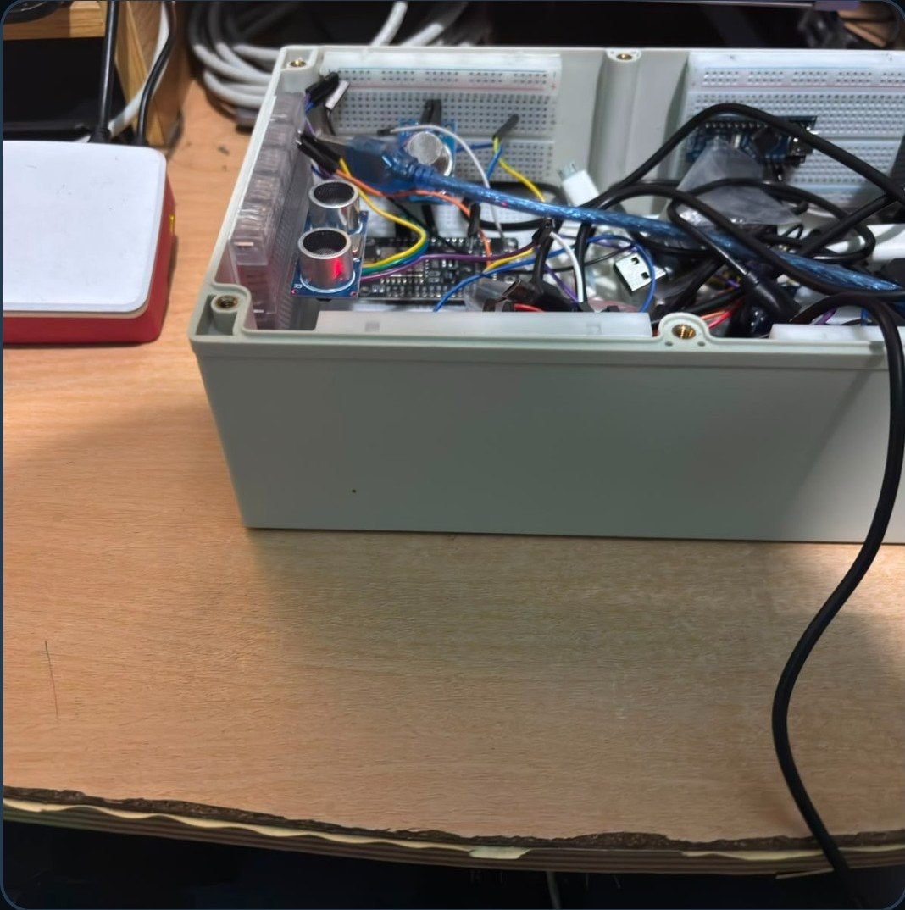
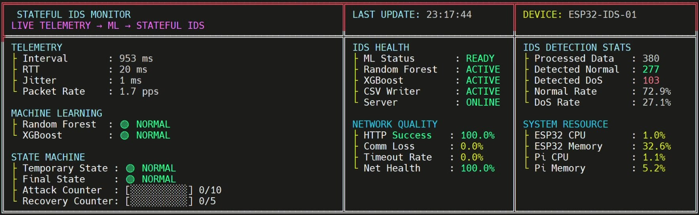
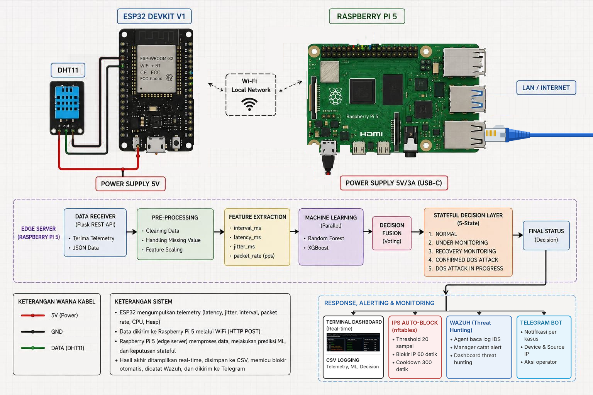
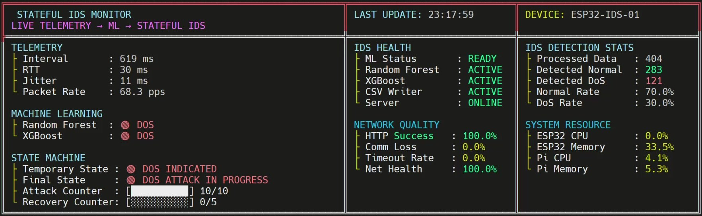
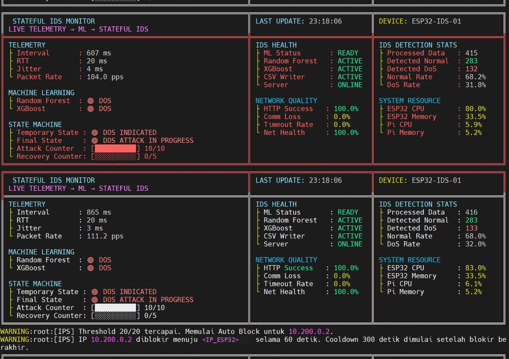
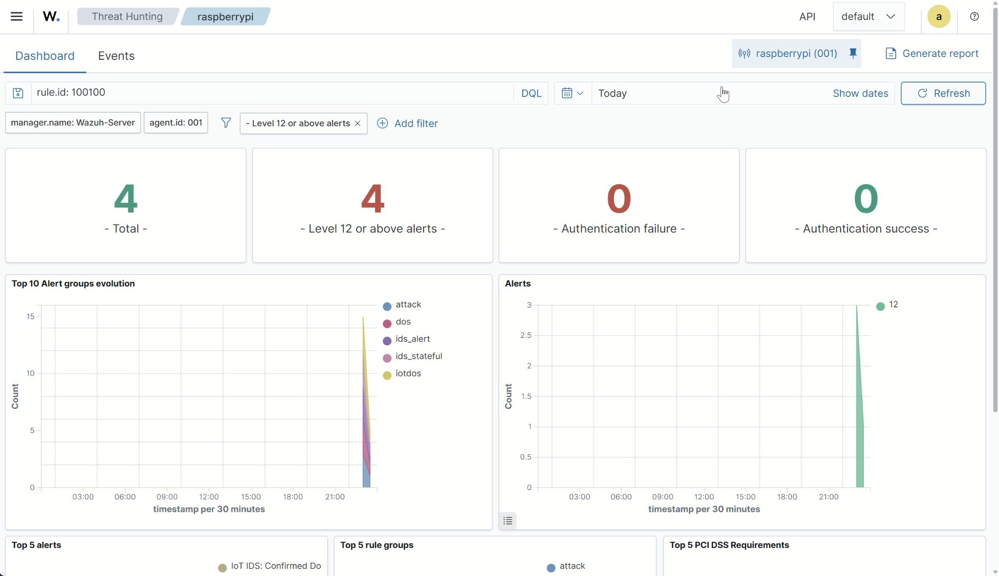

# GARDA-IoT · Stateful Edge HIPS untuk Perangkat IoT/OT

**GARDA-IoT** adalah sistem pencegahan intrusi berbasis host di sisi *edge* (Edge HIPS) yang melindungi perangkat IoT berdaya rendah dari serangan **Denial of Service (DoS)**. Deteksi, validasi, dan pemblokiran dilakukan sepenuhnya di jaringan lokal: ESP32 mengirim telemetri jaringan ke Raspberry Pi 5, dua model *machine learning* menilai setiap sampel, lapisan keputusan *stateful* memastikan serangan benar-benar konsisten, lalu IPS memblokir sumber serangan lewat **nftables**. Kejadian penting diteruskan ke **Wazuh** dan dikirim ke operator melalui **Telegram**.


> 📘 Panduan lengkap (persiapan, instalasi, pengoperasian, pengujian, troubleshooting) tersedia di **[docs/Garda_IoT_User_Manual.pdf](docs/Garda_IoT_User_Manual.pdf)**.

---

## Daftar Isi

1. [Pengenalan Sistem](#1-pengenalan-sistem)
2. [Fitur Utama](#2-fitur-utama)
3. [Arsitektur](#3-arsitektur)
4. [Cara Kerja](#4-cara-kerja)
5. [Struktur Repositori](#5-struktur-repositori)
6. [Kebutuhan Hardware & Software](#6-kebutuhan-hardware--software)
7. [Panduan Instalasi](#7-panduan-instalasi)
8. [Menjalankan Sistem](#8-menjalankan-sistem)
9. [Pengujian](#9-pengujian)
10. [Troubleshooting Singkat](#10-troubleshooting-singkat)
11. [Catatan Keamanan](#11-catatan-keamanan)
12. [Tim](#12-tim)

---

## 1. Pengenalan Sistem

Perangkat IoT seperti ESP32 tidak mampu menjalankan perangkat lunak keamanan sendiri, sementara deteksi berbasis *machine learning* per sampel cenderung menghasilkan banyak alarm palsu karena gangguan jaringan sesaat ikut dianggap serangan.

GARDA-IoT menjawab dua masalah tersebut dengan:

- **Edge processing** — seluruh analisis berjalan di Raspberry Pi 5 di jaringan lokal, tanpa bergantung pada cloud.
- **Decision fusion** — Random Forest dan XGBoost menilai sampel yang sama; hasil keduanya digabungkan.
- **Stateful decision layer** — serangan baru dinyatakan terkonfirmasi setelah **10 indikasi berturut-turut**, dan dinyatakan pulih setelah **5 sampel normal berturut-turut**.
- **IPS otomatis** — sumber serangan diblokir sementara melalui nftables, dengan masa *cooldown* agar tidak terjadi blokir berulang.
- **Pemantauan terpusat** — Wazuh untuk *threat hunting* dan laporan, Telegram untuk notifikasi dan aksi operator (tombol **IGNORE**).

| | |
|:---:|:---:|
|  |  |
| Perangkat ESP32 + DHT11 dan Raspberry Pi 5 | Dashboard terminal GARDA-IoT (kondisi normal) |

## 2. Fitur Utama

| Fitur | Keterangan |
|---|---|
| Telemetri jaringan real-time | ESP32 mengukur `interval_ms`, `rtt_ms`, `jitter_ms`, `packet_rate`, beban CPU, dan memori, lalu mengirimnya via HTTP POST |
| Dual-model ML | Random Forest + XGBoost (`edge-server/models/`) |
| Decision fusion | Sepakat NORMAL → `NORMAL`; sepakat DoS → `DOS INDICATED`; berbeda → `SUSPICIOUS` |
| State machine 5 status | `NORMAL` → `UNDER MONITORING` → `CONFIRMED DOS ATTACK` → `DOS ATTACK IN PROGRESS` → `RECOVERY MONITORING` |
| IPS auto-block | Setelah 20 sampel `DOS ATTACK IN PROGRESS`, IP sumber masuk set `blocked_attackers` (60 detik), lalu cooldown 300 detik setelah blokir berakhir (set `cooldown_guard`, timeout 6 menit) |
| Integrasi Wazuh | Log `/var/log/ids_alerts.log` → decoder & rule **100100** (level 12) → Active Response `ids-alert` |
| Notifikasi Telegram | Pesan per kasus (device, IP sumber, RTT, CPU, rule) + tombol **IGNORE — SKIP AUTO-BLOCK** |
| Dashboard terminal & CSV | Tampilan 3 panel di terminal dan log 22 kolom per sampel |
| Lingkungan uji terisolasi | Penguji DoS dijalankan di *network namespace* `ids-attacker` (10.200.0.2) dengan token rahasia |

## 3. Arsitektur



**A. Lapisan perangkat**
- **ESP32 DevKit V1 + DHT11** — perangkat IoT yang dilindungi. DHT11: merah 5V, hitam GND, hijau data ke **GPIO 4**.
- **Wi-Fi lokal** — ESP32 dan Raspberry Pi tidak terhubung kabel data; telemetri dikirim lewat Wi-Fi menggunakan HTTP POST.
- **Raspberry Pi 5 (edge server)** — menerima telemetri, menjalankan model ML, mengambil keputusan, dan memblokir serangan. Port Ethernet dipakai untuk Wazuh Manager dan Telegram.

**B. Alur pemrosesan pada edge server**

| Tahap | Yang dilakukan | Implementasi |
|---|---|---|
| Data Receiver | Menerima telemetri JSON dari ESP32 | Flask + Waitress, `POST /data` port 5000 |
| Pre-processing | Validasi JSON, *missing value*, konversi tipe, urutan kolom fitur | `terima_data()` |
| Feature Extraction | `interval_ms`, `rtt_ms`, `jitter_ms`, `packet_rate` | `FEATURE_COLS` |
| Machine Learning | RF dan XGBoost menilai sampel yang sama | `model_rf.pkl`, `model_xgb.pkl` |
| Decision Fusion | Voting dua model | `get_temporary_status()` |
| Stateful Decision Layer | 5 status, konfirmasi 10 / pemulihan 5 | `update_ids_state()` |
| Final Status | Diteruskan ke dashboard, CSV, log IDS, IPS | — |

**C. Respons, peringatan, dan pemantauan** — dashboard terminal + CSV, IPS nftables, Wazuh (agent → manager → dashboard), dan bot Telegram.

## 4. Cara Kerja

```
ESP32 ──HTTP POST /data──▶ server.py (Raspberry Pi 5)
                              │  RF + XGBoost → decision fusion → state machine
                              ├─▶ dashboard terminal + dataset_realtime_log.csv
                              ├─▶ /var/log/ids_alerts.log ──▶ Wazuh Agent ──▶ Wazuh Manager (rule 100100)
                              │                                                   │ Active Response "ids-alert"
                              │                                                   ▼
                              │                                      ids_alert.py ──▶ Telegram (alert + tombol IGNORE)
                              │                                                   ▲
                              │                     telegram_webhook.py ◀──── klik IGNORE ── operator
                              │                              │ POST /ignore
                              └─▶ IPS: nft add element inet ids_ips_auto blocked_attackers { 10.200.0.2 }
```

| Kondisi deteksi | Dashboard | IPS memblokir |
|:---:|:---:|:---:|
|  |  |  |
| `DOS ATTACK IN PROGRESS` | Aksi IPS di dashboard | Alert di Wazuh Dashboard |

## 5. Struktur Repositori

```
garda-iot/
├── firmware/
│   └── esp32_rtt/
│       ├── esp32_rtt.ino            # firmware ESP32 v6.0 (telemetri + endpoint /ping, /health)
│       └── config.example.h         # template Wi-Fi & IP → salin menjadi config.h (di-ignore git)
├── edge-server/
│   ├── server.py                    # IDS/IPS server v7.0 (Flask + Waitress, ML, state machine, IPS, dashboard)
│   ├── dos_attack.py                # pengujian DoS HTTP terkendali (dijalankan dari namespace ids-attacker)
│   ├── models/                      # model_rf.pkl, model_xgb.pkl, label_encoder.pkl
│   ├── requirements.txt             # 10 paket aplikasi & model
│   └── requirements-lock.txt        # snapshot lengkap virtual environment (25 paket)
├── alerting/
│   ├── ids_alert.py                 # Wazuh Active Response → notifikasi Telegram + Case ID
│   └── telegram_webhook.py          # controller tombol IGNORE (long polling getUpdates)
├── wazuh/
│   ├── agent/ossec.conf.example     # konfigurasi Wazuh Agent (Raspberry Pi)
│   └── manager/
│       ├── decoders/ids_decoder.xml
│       ├── rules/ids_rules.xml      # rule 100100, level 12
│       └── ossec-active-response.xml# blok <command> & <active-response>
├── deploy/
│   ├── garda.env.example            # IP perangkat & lokasi file → /etc/garda-iot/garda.env
│   ├── ids-telegram.env.example     # token bot & chat ID → /etc/ids-telegram.env
│   ├── nftables/ids_ips_auto.nft.template
│   ├── scripts/                     # setup_namespace.sh, setup_nftables.sh, create_test_token.sh
│   ├── sudoers/ids-nft.example
│   └── systemd/                     # garda-ids.service (opsional), telegram-webhook.service
├── datasets/                        # contoh log runtime + arsip eksperimen lama (lihat datasets/README.md)
└── docs/
    ├── Garda_IoT_User_Manual.pdf
    └── images/
```

## 6. Kebutuhan Hardware & Software

**Hardware**

| Komponen | Keterangan |
|---|---|
| ESP32 DevKit V1 (ESP-WROOM-32) | Perangkat IoT yang dilindungi |
| Sensor DHT11 + kabel jumper | Data ke GPIO 4 |
| Raspberry Pi 5 + microSD + adaptor USB-C 5V/3A | Edge server (Debian 13 Trixie arm64) |
| Router / access point Wi-Fi | Jaringan lokal ESP32 ↔ Raspberry Pi |
| Server / VM Ubuntu | Wazuh Manager + Indexer + Dashboard |
| Laptop operator | Arduino IDE dan klien SSH (mis. MobaXterm) |

**Software**

| Lokasi | Software |
|---|---|
| Laptop | Arduino IDE 2.x, board **esp32 by Espressif Systems**, library **ArduinoJson** (API v6) dan **DHT sensor library** (Adafruit) |
| Raspberry Pi | Python 3.13 + `python3-venv`, `nftables`, `iproute2`, `curl`, `git`, Wazuh Agent 4.14.x |
| Wazuh Manager | Wazuh Manager + Indexer + Dashboard 4.14.x (instal sesuai dokumentasi resmi Wazuh) |

## 7. Panduan Instalasi

> Label di setiap blok perintah: **[Laptop]**, **[Pi]** (Raspberry Pi 5), **[Manager]** (server Wazuh). Ganti `<user>` dengan user Linux di Raspberry Pi, dan `192.168.X.X` dengan alamat di jaringan Anda.

### 7.1 Rencanakan alamat jaringan

| Kebutuhan | Nilai | Diatur di |
|---|---|---|
| IP statis ESP32 | `192.168.X.X` | `config.h`, `garda.env` |
| IP Raspberry Pi (`wlan0`) — **harus tetap** | `192.168.X.X` | `config.h` (`EDGE_SERVER_IP`), `garda.env` |
| IP Wazuh Manager | `192.168.X.X` (1514/TCP agent, 1515/TCP enrollment, 443/TCP dashboard) | `ossec.conf` agent, `garda.env` |
| Port server IDS | `5000/TCP` di `0.0.0.0` | `server.py` |
| Namespace penguji | `ids-attacker`, `10.200.0.2` | `garda.env`, `setup_namespace.sh` |
| veth sisi host | `veth-ids-host`, `10.200.0.1` | `garda.env`, `setup_namespace.sh` |

### 7.2 Firmware ESP32 — [Laptop]

1. Arduino IDE → **File → Preferences → Additional boards manager URLs**:
   ```
   https://espressif.github.io/arduino-esp32/package_esp32_index.json
   ```
2. **Tools → Board → Boards Manager** → instal **esp32 by Espressif Systems**.
3. **Sketch → Include Library → Manage Libraries** → instal **ArduinoJson** dan **DHT sensor library** (beserta dependensinya).
4. Buat file konfigurasi dari template:
   ```bash
   cd firmware/esp32_rtt
   cp config.example.h config.h      # config.h di-ignore git, aman untuk diisi kredensial
   ```
5. Isi `config.h`:
   ```c
   #define WIFI_SSID        "YOUR_WIFI_SSID"
   #define WIFI_PASSWORD    "YOUR_WIFI_PASSWORD"
   #define EDGE_SERVER_IP   "192.168.X.X"     // IP Raspberry Pi 5
   #define GARDA_DEVICE_ID  "ESP32-IDS-01"
   #define ESP32_STATIC_IP  192,168,X,X       // pakai koma
   #define ESP32_GATEWAY    192,168,X,1
   ```
6. Buka `firmware/esp32_rtt/esp32_rtt.ino`, pilih board **ESP32 Dev Module** (atau *DOIT ESP32 DEVKIT V1*) dan port COM, lalu **Upload**.
7. Buka Serial Monitor (115200 baud). Baris `[OK] interval: … | rtt: … | pps: …` menandakan telemetri terkirim.
8. Rangkai DHT11: merah → 5V, hitam → GND, hijau (data) → **GPIO 4**.

### 7.3 Persiapan Raspberry Pi 5 — [Pi]

```bash
sudo systemctl enable --now ssh
sudo apt update
sudo apt install -y python3-venv nftables iproute2 curl git zip unzip

# Pastikan IP wlan0 tetap (reservasi DHCP di router, atau IP statis dengan NetworkManager):
nmcli -t -f NAME,DEVICE connection show --active
sudo nmcli connection modify "<NAMA_KONEKSI>" ipv4.method manual \
  ipv4.addresses 192.168.X.X/24 ipv4.gateway 192.168.X.1 ipv4.dns "8.8.8.8 1.1.1.1"
sudo nmcli connection up "<NAMA_KONEKSI>"
```

### 7.4 Clone repositori & dependensi Python — [Pi]

```bash
cd ~
git clone https://github.com/<akun-anda>/garda-iot.git
cd garda-iot/edge-server
python3 -m venv venv
source venv/bin/activate
pip install --upgrade pip
pip install -r requirements.txt          # atau requirements-lock.txt untuk snapshot lengkap
pip check
python -c "import flask, waitress, sklearn, xgboost, pandas, numpy, joblib, psutil, wcwidth, requests; print('dependensi OK')"
```

> Pertahankan **scikit-learn 1.8.0** dan **xgboost 3.2.0** agar file model `.pkl` dapat dimuat dengan benar. Hanya gunakan file model dari sumber tepercaya, karena `.pkl` dapat menjalankan kode saat dimuat.

### 7.5 Konfigurasi edge server — [Pi]

```bash
sudo mkdir -p /etc/garda-iot
sudo cp ~/garda-iot/deploy/garda.env.example /etc/garda-iot/garda.env
sudo nano /etc/garda-iot/garda.env        # isi GARDA_ESP32_IP, GARDA_PI_IP, GARDA_WAZUH_IP
sudo chmod 644 /etc/garda-iot/garda.env

# Token rahasia pengujian (header X-IDS-Test-Token) → edge-server/.ids_test_token
~/garda-iot/deploy/scripts/create_test_token.sh

# File log yang dibaca Wazuh Agent
sudo touch /var/log/ids_alerts.log && sudo chown <user>:<user> /var/log/ids_alerts.log
```

`server.py` dan `dos_attack.py` membaca `/etc/garda-iot/garda.env` (lokasi lain dapat diatur dengan variabel `GARDA_ENV_FILE`). Setiap nilai juga dapat di-override lewat environment variable. Bila kunci wajib belum diisi, program berhenti dengan pesan yang menyebut kunci tersebut.

### 7.6 Lingkungan uji (network namespace) — [Pi]

```bash
cd ~/garda-iot
sudo ./deploy/scripts/setup_namespace.sh  # jalankan ulang setiap Raspberry Pi selesai booting
```

Script membuat namespace `ids-attacker` (10.200.0.2), pasangan veth `veth-ids-host` (10.200.0.1) ↔ `veth-ids-ns`, mengaktifkan `ip_forward`, dan menambahkan NAT `ip ids_nat` (masquerade keluar `wlan0`). NAT berada di *postrouting*, setelah chain `forward` milik IPS, sehingga IPS tetap melihat IP asli penguji.

Periksa:
```bash
ip netns list                                                     # ids-attacker
sudo ip netns exec ids-attacker curl -s -m 3 http://<IP_ESP32>/ping   # pong
```

### 7.7 Firewall & IPS (nftables) — [Pi]

```bash
sudo ./deploy/scripts/setup_nftables.sh   # membuat table inet ids_ips_auto dari template + garda.env
```

Table berisi set `blocked_attackers` (timeout 1 menit), `cooldown_guard` (timeout 6 menit), dan chain `forward` yang membuang paket dari `veth-ids-host` ke ESP32 bila IP sumber ada di `blocked_attackers`.

`server.py` berjalan sebagai user biasa dan memanggil `sudo -n /usr/sbin/nft`, jadi user harus boleh menjalankan `nft` tanpa password:

```bash
sudo visudo -f /etc/sudoers.d/ids-nft     # isi: <user> ALL=(root) NOPASSWD: /usr/sbin/nft
sudo -k && sudo -n /usr/sbin/nft list table inet ids_ips_auto   # harus tampil tanpa meminta password
```

Agar table dimuat ulang setelah restart: `sudo nft list ruleset | sudo tee /etc/nftables.conf && sudo systemctl enable nftables`.

### 7.8 Wazuh Agent — [Pi]

1. Instal Wazuh Agent 4.14.x untuk Debian arm64 mengikuti dokumentasi resmi Wazuh, lalu daftarkan ke Manager.
2. Sesuaikan `/var/ossec/etc/ossec.conf` mengacu pada `wazuh/agent/ossec.conf.example` — ganti `WAZUH_MANAGER_IP` dan pastikan ada:
   ```xml
   <localfile>
     <log_format>syslog</log_format>
     <location>/var/log/ids_alerts.log</location>
   </localfile>
   ```
3. Pasang script Active Response:
   ```bash
   sudo cp ~/garda-iot/alerting/ids_alert.py /var/ossec/active-response/bin/ids_alert.py
   sudo chown root:wazuh /var/ossec/active-response/bin/ids_alert.py
   sudo chmod 750 /var/ossec/active-response/bin/ids_alert.py
   sudo systemctl restart wazuh-agent
   ```

### 7.9 Wazuh Manager — [Manager]

```bash
sudo cp wazuh/manager/decoders/ids_decoder.xml /var/ossec/etc/decoders/
sudo cp wazuh/manager/rules/ids_rules.xml     /var/ossec/etc/rules/
sudo chown wazuh:wazuh /var/ossec/etc/decoders/ids_decoder.xml /var/ossec/etc/rules/ids_rules.xml
# Tambahkan isi wazuh/manager/ossec-active-response.xml ke /var/ossec/etc/ossec.conf
# (sesuaikan <agent_id> dengan ID agent Raspberry Pi: sudo /var/ossec/bin/agent_control -l)
sudo systemctl restart wazuh-manager
```

Uji decoder dan rule:
```bash
sudo /var/ossec/bin/wazuh-logtest
# tempel baris berikut, hasil harus menunjukkan rule id 100100, level 12:
2026-11-13T23:17:55 CONFIRMED_DOS_ATTACK src_ip=10.200.0.2 rtt_ms=76 cpu_load=95.0 device=ESP32-IDS-01
```

### 7.10 Telegram — [Pi]

1. Buat bot lewat **@BotFather**, lalu kirim `/start` ke bot dari akun operator.
2. Buat file kredensial:
   ```bash
   sudo cp ~/garda-iot/deploy/ids-telegram.env.example /etc/ids-telegram.env
   sudo nano /etc/ids-telegram.env       # TELEGRAM_BOT_TOKEN, TELEGRAM_CHAT_ID (ID numerik), IDS_TEST_TOKEN_PATH
   sudo chmod 600 /etc/ids-telegram.env
   ```
3. Pasang controller tombol IGNORE:
   ```bash
   sudo cp ~/garda-iot/alerting/telegram_webhook.py /usr/local/bin/telegram_webhook.py
   sudo chmod 750 /usr/local/bin/telegram_webhook.py
   sudo cp ~/garda-iot/deploy/systemd/telegram-webhook.service /etc/systemd/system/
   sudo systemctl daemon-reload
   sudo systemctl enable --now telegram-webhook
   ```

> Meskipun bernama *webhook*, controller memakai *long polling* (`getUpdates`), sehingga tidak memerlukan alamat publik atau tunnel.

## 8. Menjalankan Sistem

Urutan menyalakan: **Wazuh Manager → Raspberry Pi → ESP32**.

```bash
# [Pi] sesi terminal 1 — server IDS/IPS (gunakan jendela lebar ± 130 kolom)
sudo ./deploy/scripts/setup_namespace.sh        # bila belum dijalankan sejak boot
cd ~/garda-iot/edge-server
source venv/bin/activate
python -u server.py
```

Pemeriksaan cepat:
```bash
curl -s http://<IP_ESP32>/ping                           # pong
curl -s http://127.0.0.1:5000/status | python3 -m json.tool
tail -n 2 ~/garda-iot/edge-server/dataset_realtime_log.csv   # bertambah setiap sampel
systemctl is-active wazuh-agent telegram-webhook
```

Opsional — jalankan server sebagai layanan: sesuaikan `<user>` di `deploy/systemd/garda-ids.service`, salin ke `/etc/systemd/system/`, lalu `sudo systemctl enable --now garda-ids`. (Dashboard terminal hanya terlihat bila server dijalankan langsung di terminal.)

| Tampilan | Akses |
|---|---|
| Dashboard terminal | Sesi SSH yang menjalankan `server.py` |
| Wazuh Dashboard | `https://<IP_WAZUH_MANAGER>` |
| API status | `curl http://127.0.0.1:5000/status` dari Raspberry Pi |

## 9. Pengujian

Pengujian DoS terkendali **hanya** dijalankan dari namespace `ids-attacker` dan memakai token `.ids_test_token`, sehingga satu-satunya IP yang dapat diblokir IPS adalah `10.200.0.2`.

```bash
# [Pi] sesi terminal 2
sudo ip netns exec ids-attacker \
  ~/garda-iot/edge-server/venv/bin/python -u \
  ~/garda-iot/edge-server/dos_attack.py
```

Parameter bawaan: 15 thread, jeda 10 ms per thread, durasi 80 detik, target `http://<IP_ESP32>/ping`. Hentikan lebih awal dengan Ctrl+C.

Urutan yang diharapkan:

1. Script menampilkan `[REGISTRATION] BERHASIL | Attacker IP: 10.200.0.2`.
2. Dashboard: `NORMAL` → `UNDER MONITORING` (counter naik hingga 10/10) → `CONFIRMED DOS ATTACK` → `DOS ATTACK IN PROGRESS`.
3. Wazuh mencatat alert rule **100100**; operator menerima pesan **🚨 WAZUH IDS ALERT** di Telegram.
4. Setelah 20 sampel `IN PROGRESS`, IPS memblokir 10.200.0.2:
   ```bash
   sudo nft list set inet ids_ips_auto blocked_attackers
   ```
5. Setelah serangan berhenti dan 5 sampel normal berturut-turut: `RECOVERY MONITORING` → `NORMAL`.
6. (Opsional) Tekan **IGNORE** di Telegram untuk melewati auto-block pada kasus tersebut; bila IP sudah terlanjur diblokir, IP dilepas kembali.

> Beri jeda lebih dari 6 menit antarpengujian agar `cooldown_guard` kedaluwarsa.

## 10. Troubleshooting Singkat

| Masalah | Periksa | Solusi |
|---|---|---|
| ESP32 tidak terhubung Wi-Fi | Serial Monitor | Periksa `WIFI_SSID`/`WIFI_PASSWORD` di `config.h`; ESP32 hanya mendukung 2,4 GHz |
| Telemetri tidak masuk | `[FAIL]` di Serial Monitor | Pastikan `EDGE_SERVER_IP` = IP `wlan0` Pi dan server berjalan di port 5000 |
| Server berhenti saat start | Pesan `[CONFIG] ... belum diatur` | Lengkapi `/etc/garda-iot/garda.env` |
| Model gagal dimuat | Versi scikit-learn/xgboost | Instal ulang dari `requirements.txt` |
| `[LOG ERROR]` di terminal | `ls -l /var/log/ids_alerts.log` | `sudo chown <user>:<user> /var/log/ids_alerts.log` |
| Registrasi penguji gagal | Keluaran `[REGISTRATION] GAGAL` | Jalankan dari namespace; pastikan `.ids_test_token` ada dan tidak kosong |
| Firewall tidak memblokir | `ips_last_action` di `/status` | Muat table (7.7), tambah izin NOPASSWD, tunggu cooldown habis |
| Wazuh Agent tidak terhubung | `/var/ossec/logs/ossec.log` | Perbaiki alamat Manager; buka port 1514/1515 TCP |
| Telegram tidak terkirim | `/var/log/ids_active_response.log` | Sesuaikan `<agent_id>`, perbaiki `/etc/ids-telegram.env`, kirim `/start` ke bot |

Panduan troubleshooting lengkap ada di Bab VII [User Manual](docs/Garda_IoT_User_Manual.pdf).

## 11. Catatan Keamanan

- Repositori ini **tidak** memuat kredensial apa pun. Kredensial Wi-Fi, IP lab, token bot Telegram, chat ID, token pengujian IDS, dan konfigurasi lengkap Wazuh Manager disimpan di file lokal yang di-ignore git:
  `firmware/esp32_rtt/config.h`, `/etc/garda-iot/garda.env`, `/etc/ids-telegram.env`, `edge-server/.ids_test_token`.
- Jangan pernah meng-commit file di atas, termasuk lewat tangkapan layar atau log.
- `dos_attack.py` hanya untuk pengujian di jaringan lab milik sendiri. Trafik uji baru dikirim setelah registrasi berhasil, dan server hanya menerima registrasi dari IP namespace penguji dengan token yang benar. IPS juga hanya memblokir IP penguji tersebut; IP ESP32, Raspberry Pi, dan Wazuh Manager dilindungi dari pemblokiran.
- Contoh alamat IP di User Manual PDF adalah nilai lab saat pengujian; di repositori ini semua alamat dibaca dari file konfigurasi.

## 12. Tim

**Kelompok Lummul** — Kartika Cyber Hackathon 2026, kategori Penangkalan (AI untuk IT/OT)

| Nama | Peran |
|---|---|
| Zidan Hibbanalloh | Team Lead · Wazuh & IoT Engineer |
| Giovanno Mudzaky Wiraatmadja | Machine Learning Engineer |
| Afryan Fanindya Prayogi | Cyber Security Engineer |

GARDA-IoT juga merupakan Tugas Akhir Zidan Hibbanalloh dan bagian dari riset Divisi Cyber Security for IoT, Internet of Things (IoT) Laboratory, Telkom University.
